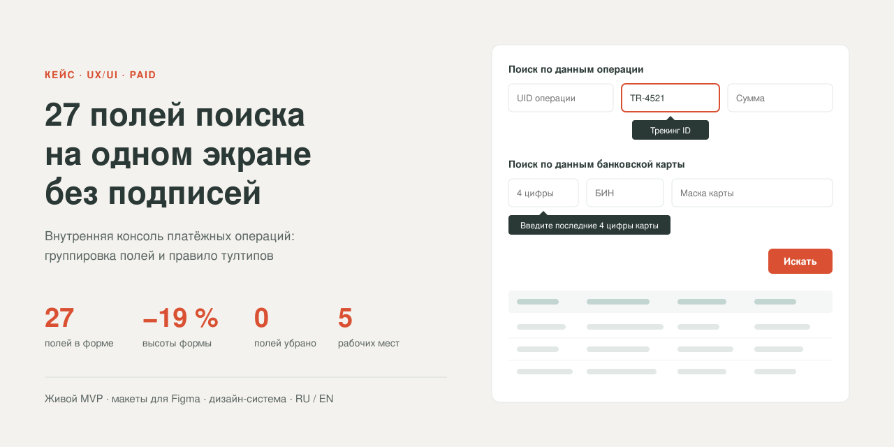
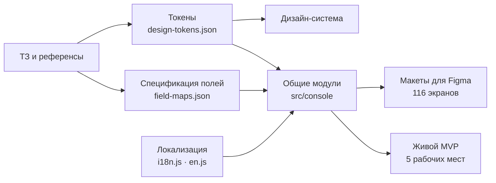

# Paid — поиск платежей на 27 полей без потери удобства



Кейс для портфолио: задача, ограничения, решение и результат.

## Коротко

| | |
|---|---|
| **Проблема** | Все 27 полей поиска нужно сохранить, форма вместе с результатами должна помещаться на экране, а для подписей над полями нет места |
| **Решение** | Смысловые группы с заголовками, название поля в плейсхолдере, тултип с названием поля, когда оно заполнено, и постоянные подсказки формата у трёх полей |
| **Результат** | Форма ниже на 17–19 %, ни одно поле не убрано, правило тултипов одинаково для обеих ролей, с мышью и с клавиатуры |

### План работы

1. **Разбор ТЗ и референсов:** 4 формы (2 роли × 2 режима), правило тултипов от заказчика, сценарии операторов.
2. **Спецификация полей:** состав и порядок полей зафиксированы в `field-maps.json` как единый источник правды.
3. **Структура формы:** группы по сценарию поиска, фиксированные ряды, ширина поля по длине значения.
4. **Правило подсказок:** дерево решений для тултипов, маски ввода и валидация.
5. **Дизайн-система:** токены и компоненты со всеми состояниями.
6. **Живой MVP и макеты для Figma** собираются из одного кода.
7. **Проверка:** замер высоты форм, сквозные сценарии в браузере, локализация.

### Архитектура экрана

```
Список платежей
├─ Шапка: роль (Администратор / Клиент) · режим (Простой / Расширенный)
├─ Панель фильтров
│   ├─ Поиск по данным операции
│   ├─ Поиск по данным банковской карты
│   ├─ Поиск по данным плательщика
│   ├─ Поиск по дате                    ← только в расширенном
│   └─ Поиск мошеннической операции     ← только в расширенном
├─ Таблица результатов: сортировка · выбор строк · пагинация · экспорт XLSX
└─ Drawer «Детали транзакции»
```

### Архитектура проекта



MVP и макеты рендерятся одними и теми же модулями, поэтому не расходятся между собой.

---

| | |
|---|---|
| **Продукт** | Внутренняя консоль платёжных операций: поиск транзакций, разбор инцидентов, выплаты, отчёты |
| **Пользователи** | Операторы поддержки, администраторы, менеджеры мерчантов, бухгалтерия и внешний клиент (мерчант) |
| **Моя роль** | UX/UI: структура форм, правила подсказок, дизайн-система, макеты и живой MVP |
| **Заказчик** | Русскоязычный; интерфейс на русском, MVP дополнительно локализован на английский |
| **Артефакты** | Живой MVP, 116 макетов для Figma, дизайн-система, схемы ИА и флоу в Miro |

---

## 1. Задача

Главный экран консоли — «Список платежей». Оператор получает жалобу («деньги списались, заказ не оплачен») и должен найти операцию по любому обрывку данных: по номеру заказа, последним цифрам карты, e-mail плательщика, сумме, дате.

### Что было в ТЗ

1. **Сохранить все поля поиска.** Набор полей уже согласован с операторами: каждое используется в реальных сценариях. Убирать, объединять и переименовывать поля нельзя.

   | Форма | Полей | Групп |
   |---|---|---|
   | Администратор, расширенный поиск | **27** | 5 |
   | Клиент, расширенный поиск | 25 | 5 |
   | Администратор, простой поиск | 20 | 3 |
   | Клиент, простой поиск | 19 | 3 |

2. **Поиск должен помещаться на экране вместе с результатами.** Оператор работает итерациями: «уточнил фильтр → посмотрел выдачу», поэтому таблица не должна уезжать за второй экран.

3. **Подписям над полями нет места.** Каждая подпись над полем добавляет строку высотой около 21 px на ряд, а длинные названия («Страна банка-эмитента», «Последние 4 цифры карты») в узких полях не помещаются.

4. **Правило подсказок от заказчика** — одинаково для клиента и администратора:
   > «Для маски карты и временного пояса — постоянный тултип по ховеру; для остальных показывать тултип по ховеру только тогда, когда поле заполнено и не видно текста плейсхолдера».

5. **Две роли и два режима.** Администратор видит внутренние поля (процессор, мерчант, хэш карты, фрод-маркер), клиент — ограниченный набор. В каждой роли есть простой и расширенный поиск.

### В чём сложность

Плейсхолдер вместо подписи — известный антипаттерн. Как только оператор начинает печатать, поле теряет имя. Через минуту в форме из 27 полей уже непонятно, что значит «4521» или «Польша»: номер заказа или ID банка, страна эмитента или эквайера. Значит, экономию места нужно чем-то компенсировать, иначе форма станет компактной, но непригодной.

---

## 2. Решение

### 2.1 Группировка вместо подписей

Поля разбиты на смысловые группы с заголовками. Заголовок задаёт контекст для всего ряда, поэтому полю хватает короткого имени в плейсхолдере.

```
Поиск по данным операции:      UID операции · Трекинг ID · Описание · Сумма · Тип · Статус · Процессор …
Поиск по данным банковской карты: Последние 4 цифры · БИН · Маска карты · Владелец · Хэш · Страна эмитента
Поиск по данным плательщика:   E-mail · Имя · Телефон · IP
Поиск по дате:                 С · По · Дата создания · Временная зона        ← только в расширенном
Поиск мошеннической операции:  Результат проверки                             ← только в расширенном
```

- **Порядок групп повторяет сценарий поиска:** сначала то, что оператор знает почти всегда (UID, сумма, статус), затем данные карты, затем данные плательщика.
- **Ширина поля соответствует длине значения:** 4 цифры карты — узкое поле, хэш карты — широкое. По ширине поле узнаётся ещё до чтения текста.
- **Ряды фиксированные.** Поле не «перетекает» в другой ряд при смене режима, поэтому мышечная память оператора не ломается.

### 2.2 Плейсхолдер — это полное имя поля

В пустом поле плейсхолдер равен названию поля («Трекинг ID»), у выпадающих списков — «Выберите статус». Отдельная подпись для пустого поля не нужна: имя и так видно.

### 2.3 Тултип возвращает подпись, когда она пропала

Это центральная часть решения. Логику я сформулировала как дерево решений:

```
Наведение или фокус на поле
 ├─ «Последние 4 цифры карты», «Маска карты», «Временная зона»?
 │     → тултип всегда: подсказка формата
 │       («Введите последние 4 цифры карты», «Маска карты 123456 xxxx 1234»,
 │        «Временная зона (GMT + 01:00) Amsterdam» — с выбранным значением)
 ├─ поле заполнено, плейсхолдер не виден?
 │     → тултип с ИМЕНЕМ поля
 └─ поле пустое
       → тултипа нет: имя видно в плейсхолдере, лишний шум не нужен
```

Почему так:
- **Тултип только у заполненного поля:** он появляется ровно тогда, когда подпись пропала. Пустые поля не «мигают» подсказками при движении мыши по форме из 27 полей.
- **В тултипе имя поля, а не значение:** значение и так видно в поле, а потерялся вопрос «что это за поле».
- **Три поля с постоянной подсказкой:** для них важен формат ввода, а не имя. Ошибка в маске карты или часовом поясе даёт пустую или неверную выдачу, которую оператор не заметит.
- **Тултип и по фокусу, а не только по наведению:** операторы много работают с клавиатуры, переходя по полям через Tab.
- **Обрезанные ячейки таблицы:** при наведении показывается полный текст.

### 2.4 Режимы и роли без отдельной формы

- **Простой и расширенный поиск.** Простой содержит 6–20 частых полей (зависит от роли), расширенный добавляет даты и проверку на мошенничество. Переключать можно и в шапке, и чекбоксом рядом с кнопкой «Искать». Заполненные значения сохраняются при переключении.
- **Роли.** У всех один набор компонентов и одна сетка, различается только состав полей. Клиент не видит внутренние данные, а IP и e-mail в выдаче у него замаскированы.

### 2.5 Ошибки, которые видно сразу

- **Маски прямо в полях:** сумма, 4 цифры, БИН из 6 цифр, маска `123456 xxxx 1234`, даты `дд.мм.гггг`, «По» не раньше «С».
- **Ошибка показывается текстом под полем**, а над формой появляется баннер со счётчиком. Фокус переходит на первое ошибочное поле, и оператор не ищет его глазами.

### 2.6 Доступность

- **У каждого поля есть `aria-label` с полным именем,** поэтому скринридер всегда читает подпись, даже когда визуально её нет.
- **Подсказка формата** привязана к полю через `aria-describedby`.
- **Контраст плейсхолдера** поднят до 4,7:1 (WCAG AA), потому что плейсхолдер здесь выполняет роль подписи.

---

## 3. Результат

Замер в живом MVP при ширине 1440 px: та же форма с подписями над полями против текущего решения.

| Форма | С подписями | Решение | Экономия |
|---|---|---|---|
| Администратор, расширенный (27 полей) | 995 px | **806 px** | −189 px (−19 %) |
| Клиент, расширенный (25 полей) | 841 px | **694 px** | −147 px (−17 %) |
| Администратор, простой (20 полей) | 679 px | **553 px** | −126 px (−19 %) |

- **Простой поиск** целиком помещается на экран 1440×900, и под ним видно начало таблицы результатов.
- **Все поля из ТЗ на месте:** ни одно не убрано и не объединено.
- **Подпись «Последние 4 цифры карты»** не поместилась бы в узкое поле даже отдельной строкой, а постоянный тултип решает это без расширения поля.
- **Правило тултипов работает одинаково** у клиента и администратора, с мыши и с клавиатуры.

### Как проверяла
- **Сквозные сценарии в браузере (48 проверок):** поиск, валидация, тултипы, сортировка, выбор строк, экспорт, drawer, переключение ролей и режимов.
- **Формы с примером данных:** на всех 32 формах «Заполнить пример» подставляет данные реальной записи, и поиск её находит.
- **Английская версия:** ни одной непереведённой строки во всех состояниях.

---

## 4. Что дальше

- **Юзабилити-тест с 3–5 операторами:** время поиска операции по жалобе, количество ошибок в масках, понятность тултипов.
- **Сохранённые наборы фильтров и история запросов** для частых сценариев («отклонённые за сегодня по мерчанту»).
- **Переключатель «показывать подписи над полями»** для новых сотрудников, пока они не запомнили раскладку.

---

## Ссылки

- Код и макеты: https://github.com/verunch/paid-ops-console
- Стартовая страница кейса: https://verunch.github.io/paid-ops-console/
- Живой MVP: https://verunch.github.io/paid-ops-console/mvp/ (английская версия — https://verunch.github.io/paid-ops-console/mvp/?lang=en)
- Описание проделанной работы и группировки макетов: [`docs/WORK-SUMMARY.md`](WORK-SUMMARY.md)
- ИА и пользовательские флоу (Miro): https://miro.com/app/board/uXjVHMdVl74=/?moveToWidget=3458764689133524864
